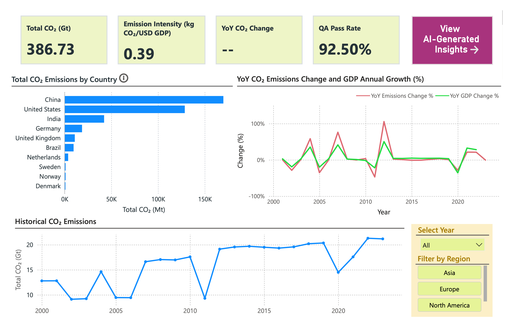
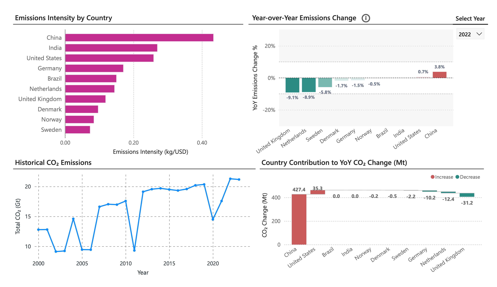
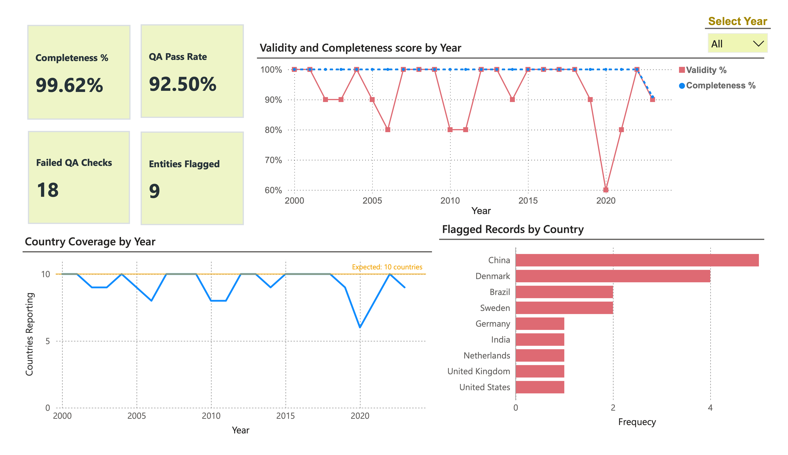
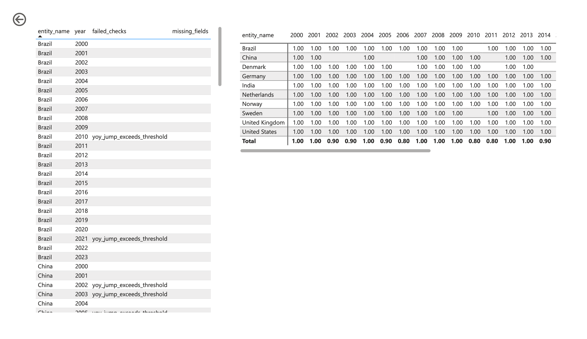
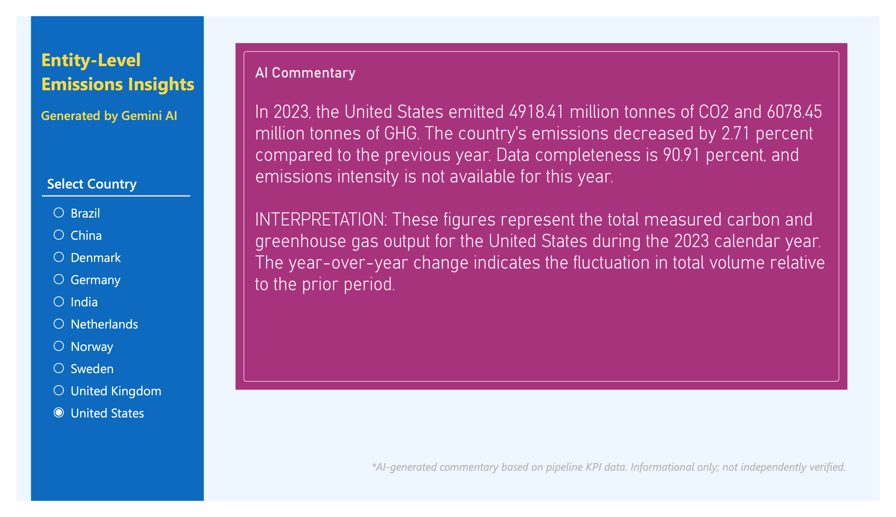

# ESG Emissions Analytics & Integrated AI-Augmented Insights

An end-to-end emissions analytics project combining **data engineering, quality assurance, interactive BI, and AI-generated commentary**. It tracks emissions and economic indicators for **10 countries used as proxies for portfolio entities**, demonstrating portfolio-exposure reporting rather than corporate emissions accounting.

## What it delivers

- **Emissions analytics:** CO₂ and GHG trends, country contributions to annual changes, GDP-based carbon intensity, and CO₂–GDP growth comparisons.
- **Data quality:** Completeness, QA pass rates, anomaly flags, and annual country coverage.
- **AI insights:** Short, entity-level Gemini summaries generated from Snowflake KPIs and displayed in Power BI. Summaries are **pre-generated**, not live API responses to report filters.

## Architecture

```text
OWID emissions data ──► Python ingestion ──► QA/QC ──► Star-schema CSVs
                                               │
                                               ▼
                                            Snowflake
                                               ├──► Power BI dashboards
                                               └──► Python + Gemini API
                                                          │
                                                          ▼
                                                    AI_SUMMARY ──► Power BI
```

**Core stack:** Python (pandas), SQL, Snowflake, Power BI, DAX, REST APIs, Gemini API, pytest.

The pipeline uses [Our World in Data](https://github.com/owid/co2-data) for its primary emissions dataset. A separate [World Bank API](https://api.worldbank.org/) ingestion script supports GDP and emissions indicators; it should not be mistaken for an automatically integrated fallback in the original QA pipeline.

## Power BI report

| Page | Focus |
|---|---|
| Executive Overview | Portfolio KPIs, country ranking, historical emissions and CO₂–GDP growth |
| Emissions Analysis | Country intensity, YoY changes and contribution waterfall |
| Data Quality Monitoring | Completeness, QA failures and reporting coverage |
| QA Details | Entity-year validation outcomes |
| AI Insights | Gemini-generated commentary for each entity's latest validated year |

[View Power BI Dashboard & AI Insights](https://github.com/mansigupta101/esg-data-pipeline/tree/feature/powerbi-ai-analytics)

### Dashboard Preview

| Executive Overview | Emissions Analysis | Data Quality | QA Details | AI Insights |
|---|---|---|---|---|
|  |  |  |  |  |

## How it works

1. `src/ingest.py` prepares the OWID country-year dataset; `src/api_ingest.py` provides an alternative World Bank API pull.
2. `src/qc_checks.py` checks required fields, value ranges and annual changes.
3. `src/star_schema.py` produces `DimEntity`, `DimDate`, `FactEmissions` and `FactDataQuality`.
4. `src/snowflake_loader.py` loads the tables to Snowflake.
5. `src/ai_commentary.py` sends validated KPI payloads to `gemini-3.1-flash-lite` and stores outputs in `AI_SUMMARY`.

### Run locally

Set up Snowflake credentials and `GEMINI_API_KEY` in a local `.env` file (**never commit credentials**), then run:

```bash
pip install -r requirements.txt
python src/ingest.py
python src/qc_checks.py
python src/star_schema.py
python src/snowflake_loader.py
python src/ai_commentary.py
pytest tests/
```

Refresh the Power BI report after loading Snowflake tables. The loader **overwrites** the target star-schema tables on reruns.

## Interpretation and limitations

- Countries are **proxies**, not actual financed companies; CO₂/GDP is an economic carbon-intensity metric, not a financed-emissions measure.
- The current QA rule **excludes** records with absolute YoY CO₂ changes above 10%, including potentially genuine changes. This can distort year-to-year comparisons when country coverage varies; the report surfaces coverage to make this visible.
- Missing GDP observations affect intensity analysis, and AI commentary is limited to the supplied KPI data. Outputs are informational and not independently verified.

**Planned improvements:** Reclassify unusual YoY changes as review flags rather than automatic exclusions; complete and validate the GDP backfill; quantify the impact of QA exclusions on emissions trends.
